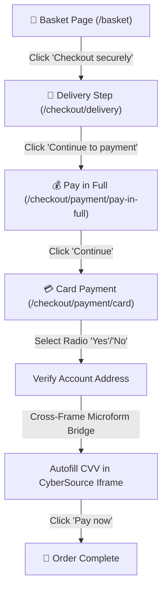

# 🛍️ VeryBot UK — Advanced Automated Shopping, Restock & Checkout Suite

> **Version:** 2.1  
> **Target Store:** [Very.co.uk](https://www.very.co.uk/)  
> **Supported Browsers:** Chrome, Edge, Brave, Firefox, Opera, Vivaldi  
> **Userscript Engine:** [Tampermonkey](https://www.tampermonkey.net/) (Recommended) / [Violentmonkey](https://violentmonkey.github.io/)  
> **Script File:** [Very Bot Script.js](Very%20Bot%20Script.js)  

**VeryBot UK** is an enterprise-grade browser automation suite engineered specifically for **Very.co.uk**. It provides automated restock detection, headless background category scanning, biometric humanized shopping, automated account login, and end-to-end checkout execution (Delivery ➔ Payment Option ➔ CyberSource Card Security Code (CVV) ➔ Pay Now).

Designed for high-demand, high-contention releases (such as Pokémon card drops, PlayStation 5 / Xbox / Switch consoles, graphics cards, luxury items, and designer sale events), VeryBot UK executes purchase workflows in seconds while maintaining strict human-like interaction heuristics to bypass automated telemetry.

---

## 📋 Table of Contents
1. [Key Features Overview](#key-features-overview)
2. [Step-by-Step Installation Guide](#step-by-step-installation-guide)
3. [HUD Console Interface Layout](#hud-console-interface-layout)
4. [Exhaustive Field-by-Field Reference](#exhaustive-field-by-field-reference)
   - [Tab 1: Dashboard Fields & Controls](#tab-1-dashboard-fields--controls)
   - [Tab 2: Targets Fields & Controls](#tab-2-targets-fields--controls)
   - [Tab 3: Profile Fields & Controls](#tab-3-profile-fields--controls)
   - [HUD Header & Navigation Controls](#hud-header--navigation-controls)
5. [In-Depth Feature Explanations](#in-depth-feature-explanations)
   - [1. Headless Background Search & Category Monitor](#1-headless-background-search--category-monitor)
   - [2. Direct Product Page (.prd) Restock Sniping & Carting](#2-direct-product-page-prd-restock-sniping--carting)
   - [3. End-to-End Multi-Step Checkout Automation](#3-end-to-end-multi-step-checkout-automation)
   - [4. CyberSource Microform Cross-Origin Iframe Bridge](#4-cybersource-microform-cross-origin-iframe-bridge)
   - [5. Anti-Bot & Biometric Humanization Engine](#5-anti-bot--biometric-humanization-engine)
   - [6. Automated Login & React State Synchronization](#6-automated-login--react-state-synchronization)
   - [7. Automated Cookie Consent Banner Dismissal](#7-automated-cookie-consent-banner-dismissal)
   - [8. Multi-Channel Alert & Webhook Engine](#8-multi-channel-alert--webhook-engine)
6. [Complete Step-by-Step Usage Workflows](#complete-step-by-step-usage-workflows)
   - [Workflow A: Monitoring a Category or Search Query for Restocks](#workflow-a-monitoring-a-category-or-search-query-for-restocks)
   - [Workflow B: Sniping an Out-of-Stock Direct Product URL](#workflow-b-sniping-an-out-of-stock-direct-product-url)
   - [Workflow C: Automated Checkout & Instant Purchase](#workflow-c-automated-checkout--instant-purchase)
   - [Workflow D: Setting a Scheduled Drop Timer](#workflow-d-setting-a-scheduled-drop-timer)
   - [Workflow E: Configuring Discord & Telegram Webhooks](#workflow-e-configuring-discord--telegram-webhooks)
7. [DOM Selectors & Technical Reference Table](#dom-selectors--technical-reference-table)
8. [Storage & Persistence Architecture](#storage--persistence-architecture)
9. [Best Practices for High-Contention Drops](#best-practices-for-high-contention-drops)
10. [Troubleshooting Guide](#troubleshooting-guide)
11. [License & Disclaimer](#license--disclaimer)

---

<a id="key-features-overview"></a>
## ⚡ Key Features Overview

- **Headless Background Category Monitoring**: Scans category and search queries in the background using authenticated session `fetch` without reloading your active tab.
- **Microsecond Auto-Buy Redirection**: Automatically opens in-stock items the instant inventory transitions from Out of Stock to In Stock.
- **Biometric Mouse Movement & Clicks**: Dispatches randomized trajectory movements, micro-jitters, natural dwell times, and non-centered click coordinates.
- **Box-Muller Gaussian Delays**: Eliminates predictable timer intervals by sampling all latencies from a bell curve distribution.
- **Automated Basket Progression**: Detects and proceeds through post-add confirmation modals and basket summaries.
- **Full Checkout Flow Execution**: Automates `/checkout/delivery`, `/checkout/payment/pay-in-full`, card address verification, and final submission.
- **CyberSource Microform Bridge**: Enters card security codes (CVV) into cross-origin CyberSource payment iframes (`https://flex.cybersource.com/*`) using Tampermonkey event channels.
- **Automated Account Login**: Populates account credentials and synchronizes values directly with React internal trackers (`_valueTracker`).
- **OneTrust Auto-Dismiss**: Silently closes cookie consent popups to prevent element interception.
- **Multi-Channel Alerts**: Web Audio 880 Hz synthesizer, native desktop push notifications, Telegram bot messages, and Discord rich embeds.
- **Movable, Resizable HUD**: Floating dashboard with Compact Mode (`275px`), Standard Mode (`380px`), and Minimized Bar (`235px`).

---

<a id="step-by-step-installation-guide"></a>
## 🚀 Step-by-Step Installation Guide

### Step 1: Install a Userscript Manager Extension
You need a browser extension capable of executing Tampermonkey userscripts:
- **Chrome / Edge / Brave / Opera / Vivaldi**: Install [Tampermonkey](https://www.tampermonkey.net/) from the Chrome Web Store.
- **Firefox**: Install [Tampermonkey](https://addons.mozilla.org/en-US/firefox/addon/tampermonkey/) or [Violentmonkey](https://addons.mozilla.org/en-US/firefox/addon/violentmonkey/) from Firefox Add-ons.

### Step 2: Create a New Script in Tampermonkey
1. Click the **Tampermonkey icon** in your browser extension toolbar.
2. Select **Dashboard** from the menu.
3. Click the **`+` (Add a new script)** tab.
4. Erase any default code present in the editor.

### Step 3: Copy and Save VeryBot Script
1. Open the [Very Bot Script.js](Very%20Bot%20Script.js) file from this repository.
2. Select all code (`Ctrl + A`) and copy it (`Ctrl + C`).
3. Paste the code into the Tampermonkey editor window (`Ctrl + V`).
4. Click **File ➔ Save** or press `Ctrl + S`.
5. Verify that `Very.co.uk Bot Script` appears active in your Tampermonkey list of installed scripts.

### Step 4: Verify on Very.co.uk
1. Navigate to [https://www.very.co.uk](https://www.very.co.uk).
2. The floating **VeryBot UK** HUD console will appear in the bottom-right corner of your screen.
3. If your browser requests permission for desktop notifications or audio playback, click **Allow**.

---

<a id="hud-console-interface-layout"></a>
## 🎛️ HUD Console Interface Layout

The floating Heads-Up Display (HUD) is injected into the webpage with the ID `#very-bot-script-ui`. It is draggable, collapsible, and divided into three primary configuration tabs:

```
+-------------------------------------------------------------+
| 🔴 VeryBot UK             [🔍 Small] [➖] [🌐 General Page] |
+-------------------------------------------------------------+
|    [ Dashboard ]       [ Targets ]       [ Profile ]        |
+-------------------------------------------------------------+
|  [ ▶ START ]                          [ ⏹ STOP ]           |
|                                                             |
|  MIN DELAY (s): [ 4 ]           MAX DELAY (s): [ 10 ]       |
|  SCHEDULE START: [ YYYY-MM-DD HH:mm ]         [ ⏳ Set ]     |
|                                                             |
| ----------------------------------------------------------- |
|  LIVE LOGS                          [ 1 In-Stock / 36 Scanned ]
|  [12:30:01] VeryBot UK initialized with humanization.       |
|  [12:30:05] Navigated: 🚚 Checkout Delivery                 |
|  [12:30:07] Clicking 'Continue to payment' button...        |
|  [12:30:10] CyberSource iframe: Card Security Code entered. |
|  [12:30:12] 🎉 All details ready. Clicking 'Pay now'...     |
+-------------------------------------------------------------+
```

---

<a id="exhaustive-field-by-field-reference"></a>
## 🔍 Exhaustive Field-by-Field Reference

Below is a complete description of every user-interactive element, input field, and toggle button available in the bot.

---

### Tab 1: Dashboard Fields & Controls

| Element Name | HTML Element ID / Class | Type | Default Value | Detailed Purpose & Behavior |
|---|---|---|---|---|
| **START Button** | `#botStartBtn` | Button | N/A | Starts the bot loop. Saves `very_bot_running = true` in `localStorage` and `GM_setValue`. Turns the status dot green (`#10b981`), disables itself, and enables the STOP button. |
| **STOP Button** | `#botStopBtn` | Button | N/A | Halts all automated actions immediately. Saves `very_bot_running = false`. Resets active states, turns the status dot red (`#ef4444`), and disables itself. |
| **Min Delay (s)** | `#botMinDelay` | Number Input | `4` | The minimum random delay (in seconds) between automated search checks or stock refresh attempts. Clamped to a minimum of `1` second. |
| **Max Delay (s)** | `#botMaxDelay` | Number Input | `10` | The maximum random delay (in seconds) between automated checks. The bot samples delay values along a Gaussian distribution between Min and Max. |
| **Schedule Start** | `#botScheduleTime` | Datetime-Local | Empty | Allows you to pick an exact future date and time for the bot to activate automatically (e.g. for scheduled 9:00 AM drops). |
| **Set Schedule Button** | `#botScheduleBtn` | Button | `⏳ Set` | Activates the countdown interval. The button changes to `🛑 (HH:MM:SS)`. When the target timestamp is reached, the bot automatically triggers `START`. Clicking it while active cancels the schedule. |
| **Live Logs Console** | `#botConsole` | Scrollable Div | Dynamic | Live terminal window showing chronological timestamps and status messages with color coding: Green (`success`), Blue (`info`), Yellow (`warning`), Red (`error`). |
| **Live Status Counter** | `#botStatsCounter` | Span Badge | `Ready` | Real-time counter showing the status of the background monitor (e.g. `2 In-Stock / 36 Scanned`) or current state. |

---

### Tab 2: Targets Fields & Controls

| Element Name | HTML Element ID / Class | Type | Default Value | Detailed Purpose & Behavior |
|---|---|---|---|---|
| **Search / Category URL to Monitor** | `#botSearchUrl` | Text Input | `https://www.very.co.uk/search/pokemon` | The full Very.co.uk category, brand, or search URL to monitor in the background. Example: `https://www.very.co.uk/toys/pokemon-cards/e/b/1589,4294916892.end`. |
| **Auto Add & Proceed to Basket** | `#botAutoBuy` | Checkbox | `checked` (`true`) | When checked, the moment any item in the monitored URL transitions to "In Stock", the bot immediately redirects your browser to that product page and adds it to your basket. |
| **Target Qty per Item** | `#botTargetQty` | Number Input | `1` | Desired purchase quantity (1–10). On product pages, the bot will automatically select this number from the `select[name="quantity"]` dropdown before adding to basket. |

---

### Tab 3: Profile Fields & Controls

| Element Name | HTML Element ID / Class | Type | Default Value | Detailed Purpose & Behavior |
|---|---|---|---|---|
| **Account Number or Email** | `#p_email` | Text Input | Pre-filled template | Your Very.co.uk registered account number or email address used for automatic login autofill on `/account/login`. |
| **Password** | `#p_password` | Password Input | Pre-filled template | Your Very.co.uk account password used for automatic login autofill. |
| **Postcode** | `#p_postcode` | Text Input | Empty | Your registered account postcode. Very occasionally requests a postcode during secondary login verification. |
| **Card Security Code (CVV)** | `#p_card_cvv` | Password Input | Empty | The 3-digit (or 4-digit) card security code printed on the back of your registered card. Stored in `localStorage` and shared with the CyberSource microform iframe via `GM_setValue`. |
| **Account Address?** | `#p_card_address` | Dropdown Select | `Yes (Registered)` | Answers the prompt *"Is the card registered at your account address?"* during payment. Options: `Yes` or `No`. Automatically checks the corresponding radio button on the checkout page. |
| **Auto Click "Pay now"** | `#p_auto_paynow` | Checkbox | `checked` (`true`) | When checked, the bot will automatically click the final "Pay now" button (`data-testid="pay-now-button"`) once the CVV and address checks are validated. If unchecked, the bot fills CVV and selects the address, but waits for you to click Pay now manually. |
| **Enable Telegram** | `#p_tg_enabled` | Checkbox | `unchecked` (`false`) | Toggles instant Telegram webhook alerts on or off. |
| **Telegram Bot Token** | `#p_tg_token` | Text Input | Empty | Your Telegram Bot API token generated from `@BotFather`. Example: `123456789:ABCdefGhIJKlmNoPQRsTUVwxyZ`. |
| **Telegram Chat ID** | `#p_tg_chat` | Text Input | Empty | Your personal Telegram user ID or channel ID where alert notifications will be delivered. |
| **Enable Discord** | `#p_discord_enabled` | Checkbox | `unchecked` (`false`) | Toggles Discord channel webhook notifications on or off. |
| **Discord Webhook URL** | `#p_discord_webhook` | Text Input | Empty | Full Discord webhook URL generated in channel settings. Example: `https://discord.com/api/webhooks/...`. |
| **Test Notifications Button** | `#botTestNotifBtn` | Button | N/A | Sends a test chime and dispatches test alert payloads to your configured Telegram and Discord channels. |
| **Save Everything Button** | `#botSaveSettingsBtn` | Button | N/A | Persists all login credentials, CVV, address preferences, webhook configurations, delays, and monitoring URLs into browser storage. |

---

### HUD Header & Navigation Controls

| Control Name | Element Selector | Purpose |
|---|---|---|
| **Size Toggle** | `#botSizeToggleBtn` | Switches the HUD between **Compact Mode** (`275px` width, ideal for laptop displays) and **Standard Mode** (`380px` width). Saves preference in `localStorage`. |
| **Minimize Button** | `#botMinToggleBtn` | Minimizes the entire HUD into a thin `235px` status bar (`➖` / `➕`) to keep your screen completely clear while monitoring in the background. |
| **Page Indicator** | `#botPageType` | Real-time badge that displays detected page context (`🌐 General Page`, `🔐 Login Page Detected`, `🛍️ Product Page Detected`, `🔍 Search Page Detected`, `🛒 Basket Page Detected`, `🚚 Checkout Delivery`, `💰 Checkout Pay in Full`, or `💳 Checkout Card & CVV`). |
| **Status Dot** | `#botStatusDot` | Circular indicator with glowing halo: Green when active, Red when stopped. |
| **Draggable Header** | `.bot-header-row` | Allows you to click and drag the HUD anywhere on your browser window. Position is maintained dynamically. |

---

<a id="in-depth-feature-explanations"></a>
## 💡 In-Depth Feature Explanations

---

### 1. Headless Background Search & Category Monitor

Standard bots reload the entire webpage repeatedly to scan for inventory, which consumes bandwidth, risks IP rate-limiting, and alerts anti-bot algorithms.

VeryBot UK uses headless background scanning:
- It issues asynchronous `fetch()` requests directly to the configured search URL (`#botSearchUrl`) with session credentials included (`credentials: 'include'`).
- The response HTML is parsed using `DOMParser()`.
- It scans up to 36 product links per cycle matching `.prd` URLs.
- It inspects the text content of each product card for stock flags: `OUT OF STOCK`, `SOLD OUT`, `CURRENTLY UNAVAILABLE`.
- It stores stock states in `sessionStorage ('very_bot_known_products')`. When an item's status switches from unavailable to available, it triggers instant audio alarms, webhook notifications, and navigates immediately to the product page.

---

### 2. Direct Product Page (.prd) Restock Sniping & Carting

When situated directly on a specific product page (URLs ending in `.prd`):
- **Stock Detection**: Checks `#primaryAddToBasket`.
- **Silent Background Polling**: If the item is sold out, VeryBot stays on the page without performing harsh page reloads. Instead, it queries the product URL silently in the background at randomized Gaussian intervals. The exact millisecond stock is replenished, it reloads the page.
- **Quantity Selector**: If `Target Qty` is greater than 1, the bot automatically simulates opening and selecting from the `select[name="quantity"]` dropdown.
- **Humanized Add to Basket**: Biometrically moves to and clicks `#primaryAddToBasket`.
- **Modal Interception**: After adding to basket, Very opens a mini-basket confirmation dialog. VeryBot intercepts this popup and clicks "Go to basket" (`a[href*="/basket"]`, `button.fuse-button`), or redirects cleanly to `https://www.very.co.uk/basket.page`.

---

### 3. End-to-End Multi-Step Checkout Automation

Once items are added to your basket, VeryBot guides your session through the entire checkout pipeline without requiring user interaction:



1. **Basket Page (`/basket` / `/basket.page`)**:
   - Locates the "Checkout securely" button (`button[data-testid="checkout-button"]`, `button._button_st30a_1.fuse-button`).
   - Clicks with natural micro-jitter pointer events and proceeds to delivery.
2. **Delivery Step (`/checkout/delivery`)**:
   - Locates `<button data-testid="continue-to-payment-button">Continue</button>`.
   - Dispatches a humanized click sequence and waits for the payment method screen.
3. **Payment Option Step (`/checkout/payment/pay-in-full`)**:
   - Locates `<button data-testid="payment-total-action">Continue</button>`.
   - Confirms the order total selection and advances to the card details view.
4. **Card Address Verification (`/checkout/payment/card`)**:
   - Very prompts: *"Is the card registered at your account address?"*.
   - The bot reads your preference (`Yes` or `No`) from `#p_card_address` and automatically checks the corresponding radio element (`[data-testid="card-address-yes"]` or `[data-testid="card-address-no"]`).
5. **Security Code Entry & Pay Now Submission**:
   - Bridges to the CyberSource microform iframe to type your CVV.
   - Once validated, biometrically clicks `<button data-testid="pay-now-button">Pay now</button>`.

---

### 4. CyberSource Microform Cross-Origin Iframe Bridge

Very.co.uk secures credit/debit card inputs using **CyberSource Flex Microform** hosted on `https://flex.cybersource.com/microform/bundle/v2.0.2/iframe.html`. 

Because this iframe is hosted on a different domain (`flex.cybersource.com` vs `very.co.uk`), browser **Same-Origin Policy (SOP)** blocks parent scripts from directly reading or modifying `iframe.contentDocument`.

VeryBot solves this through a dedicated cross-origin execution bridge:
1. **Metadata Matching**: The userscript header matches both domains:
   ```javascript
   // @match https://www.very.co.uk/*
   // @match https://flex.cybersource.com/*
   ```
2. **Selective Frame Execution**:
   - General tracking and anti-bot iframes are strictly blocked:
     ```javascript
     if (!isTop && !isCybersourceFrame) return;
     ```
   - When running inside `flex.cybersource.com`, the script executes `initCybersourceFrameHandler()`.
3. **Cross-Frame Synchronization**:
   - The parent window passes the CVV via `GM_setValue('very_bot_cvv')` and `window.postMessage({ type: 'VERY_BOT_FILL_CVV' })`.
   - Inside the CyberSource iframe, VeryBot listens for triggers, targets `input#securityCode`, focuses the element, and humanizes the typing of the security code.
   - When complete, it posts a confirmation message back to the top window, which logs `CyberSource iframe: Card Security Code entered.` and triggers the "Pay now" button.

---

### 5. Anti-Bot & Biometric Humanization Engine

Modern storefronts analyze telemetry data to differentiate bots from real users. VeryBot implements multi-layered humanization:

1. **Box-Muller Normal Distribution**:
   - Instead of fixed timers (which trigger anti-bot pattern recognition), delays are calculated using Box-Muller Gaussian mathematics (`gaussianRandom(mean, stdDev)`).
2. **Randomized Landing Coordinates**:
   - Real humans never click the exact dead-center `(width/2, height/2)` coordinate of buttons. VeryBot computes randomized landing coordinates bounded between 25% and 75% of the target element's bounding rect (`getRandomElementCoordinates`).
3. **Micro-Jitter Mouse Dynamics**:
   - Clicks dispatch a realistic series of events: `pointerover` ➔ `pointerenter` ➔ `mouseover` ➔ `mouseenter` ➔ micro-jitter `pointermove` tremor events ➔ `pointerdown` ➔ `mousedown` ➔ focus ➔ hold duration (45–130ms) ➔ `pointerup` ➔ `mouseup` ➔ `click`.
4. **Flight-Time Keystroke Latency**:
   - When typing text or credentials, VeryBot simulates individual key down, key press, key up, and variable flight latency (50–160ms) between characters, with extra realistic pauses before punctuation and special characters.
5. **React Synthetic Event & `_valueTracker` Sync**:
   - Modern React apps ignore standard `element.value = "..."` assignments. VeryBot accesses the native prototype setter (`HTMLInputElement.prototype`), resets React's internal `_valueTracker`, and dispatches bubbling `input` and `change` events so React state remains synchronized.

---

### 6. Automated Login & React State Synchronization

If your session expires during an automated run:
- The bot detects `/account/login` or sign-in prompts.
- It targets Fuse-styled inputs for **Account Number / Email** (`input[data-analyticsid="login-account-number"]`) and **Password** (`input[data-analyticsid="login-password"]`).
- If Very requests a postcode, it auto-populates your registered postcode (`#p_postcode`).
- It simulates realistic keystroke typing, updates React's internal value tracker, checks "Remember me", and clicks the "Sign In" button.

---

### 7. Automated Cookie Consent Banner Dismissal

Very.co.uk utilizes OneTrust for privacy and cookie management. Unhandled consent banners can overlay the screen and intercept click events intended for the "Add to Basket" or "Checkout" buttons.
- VeryBot runs an automatic cookie handler (`handleCookieBanner`) that detects `#onetrust-accept-btn-handler` the moment it enters the DOM and dismisses it biometrically.

---

### 8. Multi-Channel Alert & Webhook Engine

1. **Synthesized 880 Hz Audio Chime**:
   - Uses the browser's Web Audio API (`AudioContext`) to generate a clean, audible 880 Hz sine wave chime the moment an item is added to the basket or stock is found.
2. **Desktop Push Notifications**:
   - Triggers native HTML5 browser desktop notification banners showing product name and navigation links.
3. **Telegram Webhook**:
   - Transmits HTML-formatted messages with direct product links to your Telegram bot via `GM_xmlhttpRequest`.
4. **Discord Webhook**:
   - Sends formatted Discord notifications directly to any designated server channel.

---

<a id="complete-step-by-step-usage-workflows"></a>
## 📖 Complete Step-by-Step Usage Workflows

---

### Workflow A: Monitoring a Category or Search Query for Restocks

Use this workflow to monitor an entire product category (e.g. Pokémon cards, PS5 consoles, LEGO releases):

1. Navigate to [https://www.very.co.uk](https://www.very.co.uk).
2. Open the **Targets** tab in the VeryBot HUD.
3. In the **Search / Category URL to Monitor** field, enter your target search or category URL:
   - Example: `https://www.very.co.uk/search/pokemon`
   - Example: `https://www.very.co.uk/gaming/playstation-5/consoles/e/b/102931.end`
4. Ensure **Auto Add & Proceed to Basket** is checked.
5. In the **Dashboard** tab, verify your delays (recommended: Min `4s`, Max `8s` or `10s`).
6. Click **▶ START**.
7. The status dot will turn green and the console will log scan passes. The instant an item in that category becomes available, VeryBot will sound an alarm, send webhooks, and navigate directly to the product to complete checkout.

---

### Workflow B: Sniping an Out-of-Stock Direct Product URL

Use this workflow when you have the direct link to an item that is currently Out of Stock:

1. Navigate directly to the product URL (e.g. `https://www.very.co.uk/.../1601175468.prd`).
2. In the **Targets** tab, set your desired **Target Qty per Item** (default: `1`).
3. In the **Dashboard** tab, set polling delays (e.g. Min `3s`, Max `6s`).
4. Click **▶ START**.
5. The bot detects the product is Out of Stock and polls Very's servers silently in the background.
6. The instant stock is replenished, the bot reloads the page, sets your desired quantity, adds the item to the basket, and advances to checkout.

---

### Workflow C: Automated Checkout & Instant Purchase

Use this workflow to enable full hands-free purchasing through payment:

1. In the VeryBot HUD, switch to the **Profile** tab.
2. Scroll to **💳 Checkout & Card Details**:
   - Enter your card's 3-digit (or 4-digit) **Security Code (CVV)**.
   - Set **Account Address?** to `Yes` (if your card is registered at your main account delivery address) or `No`.
   - Make sure **Auto Click "Pay now"** is checked.
3. Click **💾 Save Everything**.
4. Start the bot. When an item is added to the basket:
   - On `/basket.page`, it clicks **Checkout securely**.
   - On `/checkout/delivery`, it clicks **Continue to payment**.
   - On `/checkout/payment/pay-in-full`, it clicks **Continue**.
   - On `/checkout/payment/card`, it checks your address radio button, fills your CVV into the CyberSource iframe, and clicks **Pay now**.

---

### Workflow D: Setting a Scheduled Drop Timer

Use this workflow when a drop time is announced in advance (e.g. Friday at 9:00 AM):

1. Navigate to Very.co.uk and configure your target URL in the **Targets** tab (or stay on the target product page).
2. In the **Dashboard** tab, locate **Schedule Start**.
3. Click the date/time picker and select the exact drop timestamp.
4. Click **⏳ Set**.
5. The button updates to a live countdown timer: `🛑 (HH:MM:SS)`.
6. Leave your browser open. At the exact second, VeryBot automatically engages, turns green, and begins monitoring and purchasing.

---

### Workflow E: Configuring Discord & Telegram Webhooks

Get alerts delivered directly to your smartphone or PC:

#### Telegram Configuration:
1. Open Telegram and search for [@BotFather](https://t.me/BotFather). Send `/newbot` and follow instructions to obtain your **Bot Token**.
2. Search for [@userinfobot](https://t.me/userinfobot) and send `/start` to retrieve your numeric **Chat ID**.
3. In the VeryBot HUD, go to the **Profile** tab.
4. Check **Enable Telegram**.
5. Paste your **Telegram Bot Token** and **Telegram Chat ID**.

#### Discord Configuration:
1. In Discord, go to **Channel Settings ➔ Integrations ➔ Webhooks**.
2. Click **New Webhook**, name it "VeryBot UK", and copy the **Webhook URL**.
3. In the VeryBot HUD, go to the **Profile** tab.
4. Check **Enable Discord**.
5. Paste your **Discord Webhook URL**.

#### Verification:
1. Click **🔔 Test Notifications**. You will hear the 880 Hz chime and receive test messages in both channels.
2. Click **💾 Save Everything**.

---

<a id="dom-selectors--technical-reference-table"></a>
## 🛠️ DOM Selectors & Technical Reference Table

| Target Component | Verified DOM Selector(s) | Operational Context |
|---|---|---|
| **Add to Basket Button** | `#primaryAddToBasket`<br>`button[id*="primaryAddToBasket"]`<br>`button.fuse-button` | Direct product pages (`.prd`) |
| **Quantity Selector** | `select[name="quantity"]`<br>`select.fuse-dropdown__select` | Product page quantity selection |
| **Mini-Basket / Modal Link** | `a[href*="/basket"]`<br>`button.fuse-button` | Post-add confirmation popup |
| **Checkout Securely Button** | `button[data-testid="checkout-button"]`<br>`button._button_st30a_1.fuse-button` | Basket summary page (`/basket.page`) |
| **Delivery Continue Button** | `button[data-testid="continue-to-payment-button"]`<br>`button._button_st30a_1[type="button"]` | Delivery page (`/checkout/delivery`) |
| **Payment Total Continue** | `button[data-testid="payment-total-action"]`<br>`button[type="submit"][data-variant="primary"]` | Pay in full page (`/checkout/payment/pay-in-full`) |
| **Card Address Yes Radio** | `[data-testid="card-address-yes"]`<br>`input#account-address-yes` | Card payment page (`/checkout/payment/card`) |
| **Card Address No Radio** | `[data-testid="card-address-no"]`<br>`input#account-address-no` | Card payment page (`/checkout/payment/card`) |
| **Security Code (CVV)** | `#securityCode`<br>`input[name="securityCode"]`<br>`#securityCode-container iframe` | CyberSource Microform iframe (`flex.cybersource.com`) |
| **Pay Now Button** | `button[data-testid="pay-now-button"]`<br>`button.fuse-styled-button` | Card payment page (`/checkout/payment/card`) |
| **Product Links (Search)** | `a[href*=".prd"]`<br>`div[class*="fuse-product-card"]` | Background search monitor parser |
| **Login Account / Email** | `input[data-analyticsid="login-account-number"]`<br>`input[name="accountNumber"]` | Sign-in screen (`/account/login`) |
| **Login Password** | `input[data-analyticsid="login-password"]`<br>`input[name="password"]` | Sign-in screen (`/account/login`) |
| **Login Postcode** | `input[data-analyticsid="login-postcode"]`<br>`input[name="postcode"]` | Secondary verification screen |
| **Login Submit Button** | `button[data-testid="login-continue-button"]`<br>`button.fuse-styled-button` | Sign-in submission |
| **OneTrust Cookie Button** | `#onetrust-accept-btn-handler` | Global privacy consent overlay |

---

<a id="storage--persistence-architecture"></a>
## 💾 Storage & Persistence Architecture

All settings are persisted across browser sessions in `localStorage` and synchronized with Tampermonkey's `GM` storage:

| Storage Key | Location | Type | Default Value | Description |
|---|---|---|---|---|
| `very_bot_running` | `localStorage` / `GM` | Boolean | `false` | Global run flag for the bot loop. |
| `very_bot_search_url` | `localStorage` | String | Pokémon search URL | Background category / search URL to scan. |
| `very_bot_auto_buy` | `localStorage` | Boolean | `true` | Auto-redirect and carting toggle. |
| `very_bot_target_qty` | `localStorage` | Number | `1` | Quantity to select on product pages. |
| `very_bot_min_delay` | `localStorage` | Number | `4` | Minimum interval (in seconds). |
| `very_bot_max_delay` | `localStorage` | Number | `10` | Maximum interval (in seconds). |
| `very_bot_cvv` | `localStorage` / `GM` | String | Empty | Card CVV security code. |
| `very_bot_card_address` | `localStorage` / `GM` | String | `Yes` | Card address option (`Yes` / `No`). |
| `very_bot_auto_paynow` | `localStorage` / `GM` | Boolean | `true` | Auto-submission of final payment. |
| `very_bot_email` | `localStorage` | String | Pre-filled | Account email or account number. |
| `very_bot_pass` | `localStorage` | String | Pre-filled | Account password. |
| `very_bot_postcode` | `localStorage` | String | Empty | Account verification postcode. |
| `very_bot_tg_enabled` | `localStorage` | Boolean | `false` | Telegram webhook status. |
| `very_bot_tg_token` | `localStorage` | String | Empty | Telegram Bot token. |
| `very_bot_tg_chat` | `localStorage` | String | Empty | Telegram Chat ID. |
| `very_bot_discord_enabled` | `localStorage` | Boolean | `false` | Discord webhook status. |
| `very_bot_discord_webhook` | `localStorage` | String | Empty | Discord webhook URL. |
| `very_bot_size_mode` | `localStorage` | String | `small` | HUD layout size (`small` / `normal`). |
| `very_bot_minimized` | `localStorage` | Boolean | `false` | HUD minimized state flag. |
| `very_bot_known_products` | `sessionStorage` | JSON Object | `{}` | In-memory cache of scanned items to prevent duplicate alerts. |

---

<a id="best-practices-for-high-contention-drops"></a>
## 💡 Best Practices for High-Contention Drops

1. **Pre-Authenticate Before the Drop**:
   - Log in to your Very.co.uk account manually 10–15 minutes before high-demand drops. This ensures your session cookies, saved delivery addresses, and default payment methods are active.
2. **Keep the Browser Tab Focused & Visible**:
   - Modern browsers (Chrome, Edge, Brave) aggressively throttle JavaScript timers and background tasks in minimized windows. Keep your browser window open and visible on screen.
3. **Use Realistic Polling Intervals**:
   - Setting delays below 2 seconds increases the risk of Akamai telemetry challenges. A setting of **3 to 7 seconds** provides rapid restock response while maintaining human browsing characteristics.
4. **Utilize the Scheduled Start Feature**:
   - If an item releases at a precise second (e.g. 9:00:00 AM), set the **Schedule Start** timer 1–2 minutes beforehand. The bot activates automatically at the exact second without manual intervention.

---

<a id="troubleshooting-guide"></a>
## ❓ Troubleshooting Guide

| Issue / Symptom | Possible Cause | Resolution |
|---|---|---|
| **HUD does not appear** | Userscript disabled or URL mismatch | Ensure Tampermonkey is turned ON. Verify you are browsing on `https://www.very.co.uk/*`. Refresh the page (`F5`). |
| **Security code (CVV) does not fill** | CVV not configured in Profile tab | Open the **Profile** tab, enter your CVV under **Checkout & Card Details**, and click **Save Everything**. |
| **Login inputs do not register entered text** | React value tracker out of sync | VeryBot includes a built-in React value tracker fix (`_valueTracker.setValue`). Ensure you have not modified this function in [Very Bot Script.js](Very%20Bot%20Script.js). |
| **Search scan reports HTTP 403 / Forbidden** | Missing session cookies | Browse to Very.co.uk normally first to establish session cookies. VeryBot will automatically pass these cookies in background requests. |
| **No audio chime heard on alert** | Browser autoplay policy blocked audio | Click anywhere on the Very.co.uk webpage once after loading. Browsers require at least one user gesture before allowing audio playback. |
| **Webhooks fail to deliver** | Incorrect token, webhook URL, or permissions | Use the **🔔 Test Notifications** button to test. Check the browser developer console (`F12`) for HTTP error codes. Ensure Tampermonkey granted `GM_xmlhttpRequest`. |

---

<a id="license--disclaimer"></a>
## 📄 License & Disclaimer

*Disclaimer: This software is developed for personal automation, workflow optimization, and educational research purposes. Users are solely responsible for ensuring compliance with the terms of service of the target website.*